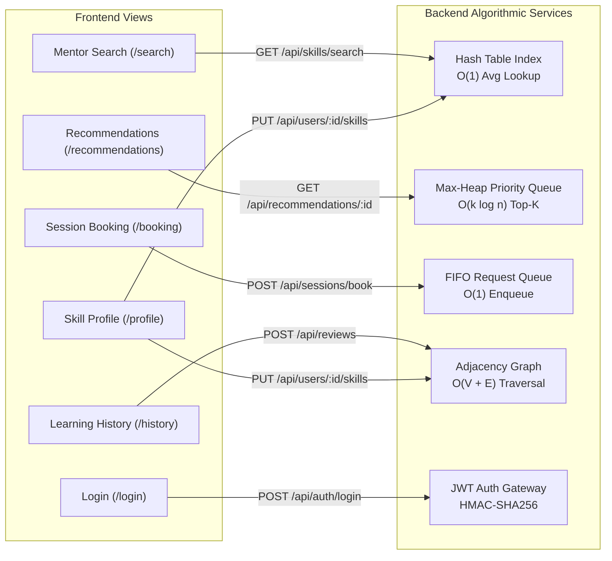
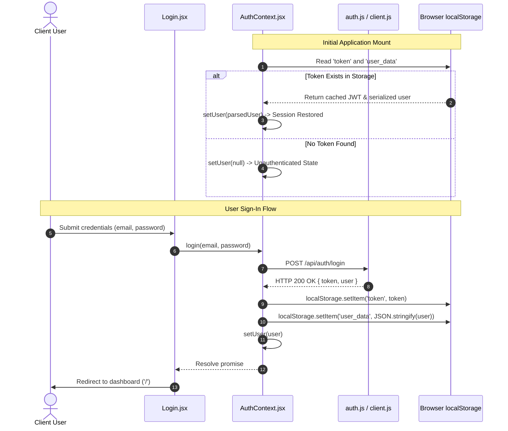

# Frontend Architecture & Technical Implementation Notes

## 1. Architectural Overview

The **Local Skill Exchange and Community Learning Platform** frontend is a Single Page Application (SPA) developed with **React 18** and **Vite**. The client interface serves three primary community roles: **Students**, **Professionals**, and **Volunteers**.

The frontend architecture prioritizes:
- **Direct Algorithmic Integration**: Every functional view maps directly to a discrete Data Structure or Algorithm (DSA) service in the backend layer.
- **Predictable State Management**: Global state is constrained to authentication and session lifecycle using native React Context.
- **Modular Service Layer**: HTTP networking, JWT injection, and error normalization are encapsulated in a resource-oriented API client layer.
- **Robust UI Feedback**: Standardized visual indicators for loading, empty datasets, network errors, and offline fallback modes.

---

## 2. Page Architecture & Backend DSA Mapping



### 2.1 View Specifications

| View Component | Route | Primary Responsibility | Connected Backend DSA Engine Feature | Complexity & Operational Mechanics |
| :--- | :--- | :--- | :--- | :--- |
| **Home (`Home.jsx`)** | `/` | Application overview, operational metrics, and navigation hub. | **System Aggregator** | Surfaces aggregate metrics from underlying Hash Tables, Graph networks, and Queue pipelines. |
| **Mentor Search (`MentorSearch.jsx`)** | `/search` | Keyword-driven mentor discovery by skill and subject tags. | **Hash Table Skill Index** | Calls `GET /api/skills/search?query=...`. The backend queries an in-memory chained Hash Table index mapping skill tokens to sets of mentor identifiers, achieving **$O(1)$ average-case lookup** without full-table scans. |
| **Recommendations (`Recommendations.jsx`)** | `/recommendations` | Personalized mentor suggestions feed ranked by composite affinity. | **Max-Heap (Priority Queue)** | Calls `GET /api/recommendations/:userId`. The backend computes a composite affinity score (skill overlap, reputation rating, and network proximity) and inserts candidate mentors into a **Max-Heap** to extract the **top-$k$ matches in $O(k \log n)$** time. |
| **Session Booking (`SessionBooking.jsx`)** | `/booking` | Mentorship scheduling interface for 1:1 and group sessions. | **FIFO Queue Pipeline** | Calls `POST /api/sessions/book`. Booking requests enter a strict **First-In, First-Out (FIFO) Queue** in $O(1)$ time to process scheduling transactions sequentially and prevent double-booking collisions. |
| **Learning History (`LearningHistory.jsx`)** | `/history` | Chronological session timeline and post-session peer review portal. | **Mentor Network Graph** | Calls `GET /api/users/:id/history` and `POST /api/reviews`. Submitting verified reviews modifies relationship edge weights and reputation scores within the **Adjacency Graph**. |
| **Skill Profile (`SkillProfile.jsx`)** | `/profile` | Profile editor for taught skills (with proficiency levels), learning goals, and bio. | **Hash Table & Graph Node Updates** | Calls `PUT /api/users/:id/skills`. Modifies user vertex properties in the **Adjacency Graph** and re-indexes taught tokens in the **Hash Table**. |
| **Login (`Login.jsx`)** | `/login` | User authentication portal with demo persona shortcuts. | **JWT Auth & API Gateway** | Calls `POST /api/auth/login`. Authenticates credentials, validates hashed passwords (bcrypt), and issues a signed JSON Web Token. |

---

## 3. State Management & Authentication Lifecycle

### 3.1 Design Rationale: React Context vs External State Libraries

Global state is managed via React's native **Context API** (`src/context/AuthContext.jsx`) rather than external libraries such as Redux or Zustand.

- **Zero Additional Overhead**: Avoids introducing external runtime dependencies for state that is predominantly read-only across most views.
- **Single Source of Truth**: Authentication status (`user`, `token`, `isLoading`, `isAuthenticated`) is consolidated into a single provider wrapping the root component tree.
- **Maintainability**: Context paired with standard `useState` and `useEffect` produces clean, auditable code with minimal boilerplate.

### 3.2 Authentication Flow & Persistence



### 3.3 Session Restoration Mechanics
1. **Hydration**: When the application loads, `AuthContext` executes a `useEffect` hook that checks `localStorage` for `token` and `user_data`.
2. **Consistency**: If valid serialized data exists, the `user` state is populated before children render, preventing authentication flicker.
3. **Termination**: Invoking `logout()` purges both storage keys and resets `user` to `null`.

---

## 4. API Layer & Service Architecture

The frontend abstracts all backend communication into a dedicated service layer under `src/api/`.

```
src/api/
├── client.js           # Central HTTP fetch wrapper, JWT injection, & error parsing
├── auth.js             # User authentication and profile retrieval endpoints
├── skills.js           # Skill search indexing and profile skill updates
├── sessions.js         # Booking queue dispatch and session history retrieval
└── recommendations.js  # Algorithmic recommendation queries
```

### 4.1 Architectural Advantages
1. **Resource Decoupling**: UI components remain decoupled from HTTP concerns (headers, serialization, status codes) and interact exclusively with typed async functions.
2. **Unified Interception**: `client.js` automatically attaches the active JWT to the `Authorization: Bearer <token>` header for all outgoing requests.
3. **Endpoint Maintainability**: Base URLs and route paths are maintained in single resource files, ensuring that backend API refactoring does not require changes to UI components.

---

## 5. Fault Tolerance & Offline Fallback Architecture

### 5.1 Design Purpose
In distributed web systems, frontend clients should maintain operational stability during transient backend outages, network partitions, or offline demonstration scenarios.

### 5.2 Implementation
1. **Error Interception**: `src/api/client.js` wraps standard `fetch()` invocations in structured `try...catch` blocks.
2. **Graceful Fallback**: If the backend service is unreachable (e.g. `ERR_CONNECTION_REFUSED`), the client serves realistic in-memory dataset fixtures and flags the response payload with `isMock: true`.
3. **Visual Transparency (`DemoBanner`)**:
   - Whenever `isMock: true` is detected, components render the `DemoBanner` component:
     ```
     [DEMO MODE] Backend Offline: Displaying simulated local data for live demonstration.
     ```
   - This prevents ambiguous system states and guarantees transparent operation during technical evaluations.

---

## 6. Key Engineering Decisions & Trade-Offs

### 6.1 Functional Components & Hooks
All components are implemented as functional components utilizing standard React hooks (`useState`, `useEffect`, `useContext`, `useSearchParams`, `useNavigate`). This ensures concise lifecycle management, predictable re-renders, and full compatibility with React 18 concurrent features.

### 6.2 Client-Side Validation
Forms (e.g. `SkillProfile.jsx`, `SessionBooking.jsx`) execute client-side validation prior to network dispatch:
- **Duplicate Prevention**: `SkillProfile.jsx` validates skill names against existing entries using `Array.prototype.some()` to prevent duplicate tag allocations.
- **Temporal Validation**: `SessionBooking.jsx` validates both date and time inputs and formats them to ISO 8601 strings (`new Date(...).toISOString()`) before enqueuing.

### 6.3 Modular Feedback Hierarchy
UI states are separated into discrete, declarative feedback components (`src/components/Feedback.jsx`):
- `<Loader />`: Asynchronous request pending state.
- `<EmptyState />`: Zero-result dataset presentation with context-specific recovery actions.
- `<ErrorState />`: Structured error presentation with retry callbacks.
- `<SuccessState />`: Positive mutation confirmations.
- `<DemoBanner />`: Explicit offline demonstration indicator.

---

## 7. Backend Data Structures, Reputation Engine, and PostgreSQL Reconciliation (Viva Reference)

### 7.1 PostgreSQL as the Authoritative Source of Truth
PostgreSQL is the single persistent source of truth for all users, skills, verification applications, session bookings, conversations, messages, attachments, and session reviews. All custom Data Structures and Algorithms (`backend/dsa/`) operate as live, in-memory indexing, ranking, traversal, and validation layers that are **hydrated from PostgreSQL on startup** and **reconciled with PostgreSQL on every write transaction**.

### 7.2 Custom Data Structures & Their Active Roles

| DSA Module | Implementation File | Core Data Structure & Algorithm | Active Operational Role | Time Complexity |
| :--- | :--- | :--- | :--- | :--- |
| **Hash Table** | `backend/dsa/hashTable.js` | Custom Hash Table with polynomial rolling hash ($p = 31$), separate chaining, and dynamic resizing at load factor $\alpha > 0.75$. | 1. **`skillHashTable`**: Indexes canonical teachable skill names to mentor records for fast lookup in `GET /api/skills/search`.<br/>2. **`reputationEngine.teacherTable`**: Indexes `teacher_id` to aggregated review lists, raw average, and Bayesian-damped reputation score. | $O(1)$ average insert & lookup |
| **Reputation Engine** | `backend/dsa/reputationEngine.js` | Bayesian-damped mean backed by `HashTable`. | Aggregates authentic learner session reviews (`1`–`5` stars) per teacher, prevents single-review volatility, and persists bounded reputation scores ($[1.00, 5.00]$) to `users.reputation_score`. | $O(1)$ lookup, $O(r)$ recompute for $r$ reviews of a teacher |
| **Max-Heap Priority Queue** | `backend/dsa/heap.js` | Binary Max-Heap (`siftUp`, `siftDown`, `extractTopK`). | Ranks eligible candidate mentors in `GET /api/recommendations/:userId` by a composite affinity score capped in $[0, 100]$ and extracts the top-$k$ mentors. | $O(n \log n)$ build, $O(k \log n)$ top-$k$ extraction |
| **Adjacency List Graph + BFS** | `backend/dsa/graph.js` | Weighted undirected Adjacency List Graph (`Map<vertexId, Map<neighborId, edgeData>>`) with Breadth-First Search (BFS). | Models peer connections and completed mentoring sessions. Computes exact shortest-path degrees of separation (`getDegreesOfSeparation`) for recommendation proximity scoring and `/api/network/proximity/:userId`. | $O(V + E)$ BFS traversal |
| **FIFO Queue** | `backend/dsa/queue.js` | Pointer-indexed First-In, First-Out (FIFO) Queue (`head`, `tail`). | Orders pending session booking requests chronologically (`enqueue` on `POST /api/sessions/book`) and reconciles when teachers accept, decline, or cancel bookings. | $O(1)$ enqueue, dequeue, and peek |
| **Verification Decision Tree & Lifecycle FSM** | `backend/dsa/decisionTree.js` | Rule-based Decision Tree (`VerificationDecisionTree`), Resume Document Pre-Checker (`ResumePreChecker`), and Finite State Machine (`VerificationLifecycleManager`). | Pre-validates uploaded PDF resumes (magic-byte header, size, academic/experience sections), computes a reviewer priority score, and enforces legal state transitions (`draft` $\rightarrow$ `submitted` $\rightarrow$ `under_review` $\rightarrow$ `approved` / `rejected` / `needs_information`). | $O(d)$ tree depth evaluation |

### 7.3 Bounded Bayesian Reputation Formula
To ensure that a single outlier rating (e.g., one `1`-star or `5`-star review on a new teacher) cannot cause an unreasonable swing, `ReputationEngine.calculateBoundedScore(ratings)` (`backend/dsa/reputationEngine.js`) uses a **Bayesian-damped mean**:

$$
R_{\text{bounded}} = \text{clamp}\left(\frac{m \cdot R_0 + \sum_{i=1}^{n} r_i}{m + n},\; 1.00,\; 5.00\right)
$$

- **Neutral Prior ($R_0 = 4.0$)**: Baseline expectation before a teacher accumulates many reviews.
- **Confidence Weight ($m = 3$)**: Equivalent to 3 virtual prior reviews at $4.0$.
  - Example: A teacher receiving a single `1`-star review shifts from $4.00$ to $\frac{3(4.0) + 1}{3 + 1} = 3.25$ rather than collapsing to $1.00$.
  - Example: A teacher receiving a single `5`-star review moves smoothly from $4.00$ to $\frac{3(4.0) + 5}{3 + 1} = 4.25$.
  - As $n$ grows, the score converges toward the teacher's true empirical mean $\bar{r}$ while always remaining strictly bounded within $[1.00, 5.00]$.

### 7.4 Max-Heap Composite Recommendation Formula
`MaxHeap.computeRecommendationScore(mentor, learnerDesiredSkills, networkDistance)` (`backend/dsa/heap.js`) computes a bounded $[0, 100]$ score across three weighted factors:
1. **Skill Overlap & Proficiency (0–40 pts)**: Up to 25 pts for the ratio of matched desired skills plus up to 15 pts for the teacher's proficiency level (`expert` = 15, `intermediate` = 10, `beginner` = 6).
2. **Community Reputation (0–40 pts)**: Linearly scaled from the teacher's bounded reputation score $\left(\frac{\text{clamp}(R, 0, 5)}{5} \times 40\right)$.
3. **Graph BFS Network Proximity (0–20 pts)**:
   - `1` hop (direct peer connection or past session): **20 pts**
   - `2` hops (mutual peer connection): **14 pts**
   - `3` hops: **8 pts**
   - `> 3` hops or disconnected: **3 pts**

The sum is rounded and clamped to $[0, 100]$ before insertion into the `MaxHeap`.

### 7.5 Startup Hydration & Write-Time Reconciliation Flow
1. **Server Startup (`initializeDatabaseAndDsa` in `backend/server.js`)**:
   - Queries all rows from `reviews` (joined with `users` and `session_bookings`) and calls `reputationEngine.rebuildFromReviews(rows)` to populate the internal `HashTable` (`teacherTable`) and reconcile `users.reputation_score` in PostgreSQL for every reviewed teacher.
   - Queries all users and teachable `skills` (`type = 'teach'`) from PostgreSQL to populate `skillHashTable` and `mentorGraph` vertices.
   - Queries `connections` (`status = 'connected'`) and `session_bookings` (`status = 'completed'`) to populate `mentorGraph` edges.
   - Queries pending `session_bookings` (`status IN ('pending', 'queued')` ordered by `created_at ASC`) to hydrate `bookingQueue`.
2. **Write-Time Reconciliation**:
   - **On Review Submission (`POST /api/reviews`)**: Inserts the new review into PostgreSQL (`UNIQUE(session_id)` enforced at both API and schema levels), calls `reputationEngine.updateTeacherReputationFromDatabase(mentorId, query)` to recompute and persist `users.reputation_score`, calls `reconcileTeacherDsaState(mentorId)` to refresh `skillHashTable` and `mentorGraph` vertex metadata, and calls `mentorGraph.updateEdgeWeight(learnerId, mentorId, rating, true)`.
   - **On Skill Update (`PUT /api/users/:userId/skills`) or Verification Approval (`POST /api/teacher-verification/admin/application/:id/review`)**: Persists changes in PostgreSQL first, then invokes `reconcileTeacherDsaState(userId)` so `skillHashTable` and `mentorGraph` immediately reflect the latest verified skills and reputation score.
   - **On Session Booking Lifecycle (`POST /api/sessions/book`, `/accept`, `/decline`, `/cancel`)**: Updates `session_bookings` in PostgreSQL and calls `reconcileBookingQueueFromDatabase()` so the in-memory FIFO `Queue` always mirrors pending database bookings.

